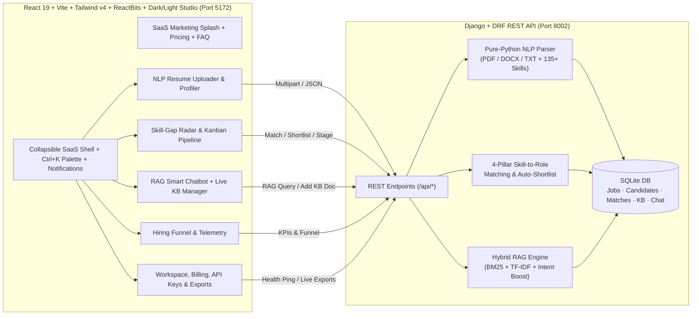

# TalentLens AI — SaaS Recruitment Intelligence Platform & Smart RAG Chatbot

**Author:** Dharshini A  
**Stack:** Django 6 · Django REST Framework · Pure-Python NLP & Hybrid RAG (BM25 + TF-IDF) · React 19 · Vite · Tailwind CSS v4 · Recharts · Framer Motion · ReactBits UI

An investor-grade AI recruitment SaaS platform featuring a **first-class Dark / Light Mode studio system**, **multi-workspace ATS shell**, **global `Ctrl+K` Command Palette**, **automated Pure-Python NLP resume parsing**, **citation-backed Hybrid RAG chatbot**, **4-pillar skill-to-role shortlisting pipeline**, and **Workspace Billing, API Keys, Webhooks & 1-click CSV/JSON Data Exports**.

---

## SaaS Platform Upgrades & Highlights

- **First-Class Dark / Light Mode System (`ThemeContext.jsx`, `ThemeToggle.jsx`, `index.css`)**
  - Animated Framer Motion Sun/Moon spring toggle persisted in `localStorage` (`talentlens_theme`, default `dark`) with zero-FOUC inline hydration in `index.html`.
  - Complete **Cosmic Dark** (`#070614` obsidian + electric violet/fuchsia/sky glow) and **Editorial Light** (`#F7F6FC` lavender-snow canvas, pure white frosted glass, deep `#0F172A` typography, crisp `#7C3AED` / `#DB2777` / `#0284C7` accents) across every single view, modal, Kanban column, resume dropzone, chat bubble, citation drawer, and Recharts graph.
  - Dynamically themed ReactBits shaders: `Particles` switches to crisp violet/sky neural nodes on light canvas, and `Orb` renders an iridescent pearl-violet glass orb in Light Mode.

- **Full SaaS Marketing & Product Splash Page (`LandingSplash.jsx`)**
  - Sticky frosted SaaS Top Navbar with smooth-scroll section anchors (*Capabilities*, *RAG Architecture*, *Pricing*, *FAQ*), live API latency indicator, Dark/Light `ThemeToggle`, and *Launch Hiring Studio* CTA.
  - Infinite **Trusted-By Talent Teams Marquee**, live `/api/overview/` `CountUp` platform telemetry bar, 3 interactive capability bento cards, 4-stage architecture showcase, Enterprise Trust Strip (SOC 2 Ready, Bias-Audited Scoring, Zero-Leakage Python RAG, GDPR Export), **SaaS Pricing** with animated Monthly / Annual (Save 20%) toggle across 3 tiers (*Recruiter Starter*, *Growth Hiring* with `BorderBeam`, *Enterprise ATS*), and interactive **FAQ Accordion**.

- **Multi-Workspace SaaS ATS & AI Shell (`App.jsx`)**
  - **Collapsible SaaS Left Sidebar** (desktop rail + mobile drawer) with **Organization / Hiring Workspace Switcher** (*TalentLens HQ — Engineering*, *Campus Hiring 2026–27*, *AI Research Recruiting*), categorized navigation (*Recruiting* & *Platform*), and a **Live Plan & Quota Meter** wired to real parsed candidate & RAG chunk counts.
  - **Enterprise Top Command Bar** with global **`Ctrl+K` / `⌘K` Command Palette** (`CommandPalette.jsx`) to search live candidates by skill, jump to roles, toggle theme, or export data; real **Django Engine Latency Pill** (`/api/health/`); **Hiring Notifications Center Drawer** (`NotificationsDrawer.jsx`) with unread counter, real recruiting alerts, and stacked toast feedback; plus toggleable floating ReactBits **`Dock`**.

- **Workspace, Billing, Developer API & Data Exports (`SaaSSettingsView.jsx`)**
  - **Appearance & Hiring Org**: Visual Dark/Light theme switcher cards, floating Dock toggle, workspace branding, and Default Auto-Shortlist Threshold slider (`50%–90%`, wired directly to Matching Pipeline).
  - **Plan & Metered Usage**: Live usage bars wired to `/api/overview/`, interactive Plan Upgrade drawer, and subscription invoice history.
  - **API Keys & ATS Webhooks**: Live Django `/api/health/` ping diagnostic, generate/mask/copy/revoke `tl_live_...` API keys, and configurable ATS webhook triggers (`candidate.parsed`, `candidate.shortlisted`, `rag.doc_indexed`, `candidate.stage_changed`) with test dispatch.
  - **Data Exports & Audit Trail**: Real 1-click **Export Candidates CSV**, **Export Skill Matches CSV**, and **Export Full Talent Snapshot JSON** directly from live Django API data, alongside a live session governance audit log.

---

## Core AI & Recruiting Engines

- **Pure-Python NLP Resume Parsing Engine (`backend/recruitment/nlp_parser.py`)**
  - Natively ingests **`.pdf`** (`pypdf`), **`.docx`** (zero-dependency pure-Python `zipfile` + `xml.etree.ElementTree` parsing `word/document.xml`), **`.txt`**, and raw pasted resume text.
  - Custom tokenizer, stopword filter, Porter-style stemmer, n-gram extractor, and **135+ technical & domain skills taxonomy** across 6 categories (`Languages`, `Frameworks`, `Databases`, `AI/ML/NLP`, `Cloud/DevOps`, `Core CS`) with synonym/alias canonicalization.
  - Extracts Name, Email, Phone, Location, LinkedIn/GitHub links, Education & CGPA/GPA, Experience Duration, Seniority Level, Projects, Certifications, **ATS Quality Score (0–100)** with strengths & improvement tips, and an automated preliminary screening summary.
  - Auto-evaluates every parsed candidate against all open job roles immediately upon upload.

- **Hybrid RAG Recruitment Chatbot (`backend/recruitment/rag_engine.py`)**
  - Indexes overlapping chunks from `KnowledgeDocument` policies/FAQs **plus dynamically synthesized live records** from `JobRole` and `Candidate` models.
  - Combines **BM25** lexical scoring + **sublinear TF-IDF cosine similarity** + **intent classification & metadata boosting** (`applicant_faq`, `candidate_search`, `role_info`, `pipeline_analytics`).
  - Returns grounded markdown answers with expandable **Retrieved RAG Sources & Relevance Scores**, confidence ratings, and contextual follow-up prompt chips.
  - Supports **Live Knowledge Base Management**: add a brand-new HR policy or FAQ document from the UI and immediately retrieve answers from it.

- **Skill-to-Role Matching & Shortlisting Pipeline (`backend/recruitment/matching_engine.py`)**
  - Transparent 4-pillar weighted scoring model:
    - **Required Skills Match (45%)** — canonical alias normalization + domain adjacency
    - **Preferred Skills Match (20%)**
    - **Experience & CGPA Readiness Fit (15%)**
    - **Candidate Assessment & ATS Quality Insights (20%)**
  - Generates recommendation tiers (`STRONG_MATCH`, `GOOD_FIT`, `POTENTIAL`, `LOW_FIT`), explainable hiring rationales, interactive **Skill-Gap Radar Charts**, configurable **Auto-Shortlist Top N**, and a 6-stage **Pipeline Kanban Board**.

---

## System Architecture



---

## ReactBits Interactive UI Showcase

Engineered with dual **Cosmic Dark** & **Editorial Light** palettes featuring 20 custom theme-aware ReactBits components in `frontend/src/components/reactbits/`:

- **Backgrounds & Shaders:** `Particles` (mouse-repelling neural constellation adapting colors per theme), `Orb` (luminous plasma orb in Dark Mode / iridescent pearl-violet glass orb in Light Mode), `ClickSpark` (global radial click bursts).
- **Kinetic Typography:** `SplitText`, `BlurText`, `ShinyText`, `GradientText`, `DecryptedText`, `RotatingText`, `CountUp`, `TrueFocus`.
- **Interactive Surfaces & Navigation:** `SpotlightCard`, `TiltedCard`, `Magnet`, `StarBorder`, `Dock` (toggleable magnifying floating dock), `PillNav`, `AnimatedList`, `GlareHover`, `BorderBeam`.

---

## REST API Reference (`http://localhost:8002/api`)

| Method | Endpoint | Description |
| :--- | :--- | :--- |
| `GET` | `/api/health/` | Service health check, live latency diagnostic, and entity counts |
| `GET` | `/api/overview/` | Dashboard KPIs, hiring funnel breakdown, skill demand vs. supply, top matches |
| `GET / POST` | `/api/jobs/` | List open job roles or create a new role (auto-runs matching pipeline) |
| `GET / PATCH / DELETE` | `/api/jobs/<id>/` | Inspect, update, or remove a job role |
| `POST` | `/api/jobs/<id>/match-all/` | Re-run weighted matching pipeline across all candidates for a role |
| `POST` | `/api/jobs/<id>/auto-shortlist/` | Auto-shortlist top `N` qualifying candidates above threshold |
| `GET / POST` | `/api/candidates/` | List/filter parsed candidates with top role matches |
| `POST` | `/api/candidates/parse-resume/` | Parse `.pdf`, `.docx`, `.txt` file upload or pasted JSON resume text |
| `PATCH` | `/api/candidates/<id>/stage/` | Move candidate across pipeline stages (`NEW` → `OFFER`) |
| `GET` | `/api/matches/` | Filterable match evaluations (`?job_role=<id>&candidate=<id>`) |
| `GET / POST` | `/api/knowledge/` | List indexed RAG knowledge documents or add & chunk a new live document |
| `DELETE` | `/api/knowledge/<id>/` | Remove a document from the RAG Knowledge Base |
| `POST` | `/api/chat/query/` | Query hybrid BM25 + TF-IDF RAG chatbot (returns answer, citations, follow-ups) |
| `GET` | `/api/chat/history/` | Fetch persisted chat sessions and messages |

---

## Quick Start (Windows One-Click Launcher)

Simply double-click **`start.bat`** (or run `start.bat` from Command Prompt):

```bat
start.bat
```

`start.bat` automatically checks Python & Node.js, creates `backend\.venv`, installs `requirements.txt`, applies migrations, runs the idempotent `seed_recruitment` command (5 job roles, 8 NLP-parsed candidates including Dharshini A, and 10 HR knowledge documents), installs `frontend\node_modules` if needed, starts Django (`:8002`) and Vite (`:5172`), and launches `http://localhost:5172` in your browser!

---

## Manual Setup Instructions

### 1. Backend (Django API on Port 8002)
```bash
cd backend
python -m venv .venv
# Windows:
.venv\Scripts\activate
# macOS / Linux:
# source .venv/bin/activate

pip install -r requirements.txt
python manage.py migrate
python manage.py seed_recruitment
python manage.py runserver 0.0.0.0:8002
```

### 2. Frontend (React + Vite on Port 5172)
```bash
cd frontend
npm install
npm run dev
```

Open **http://localhost:5172** in your browser.
